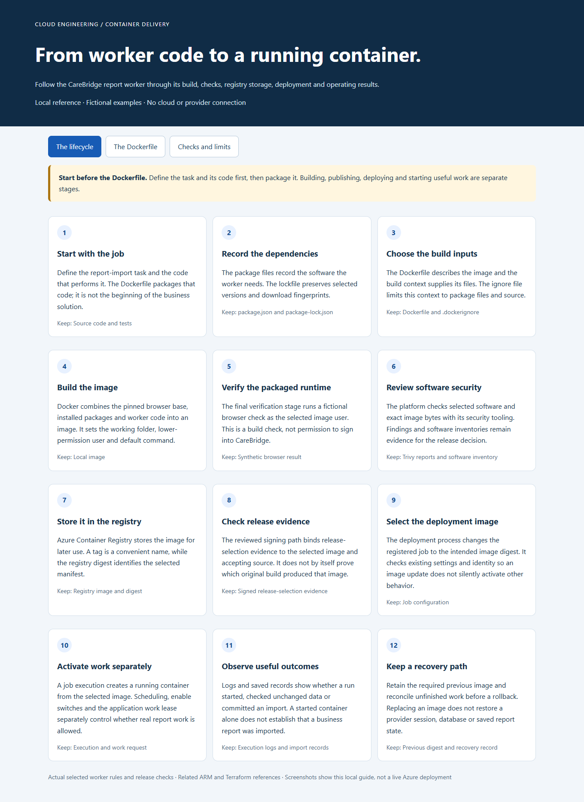
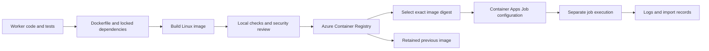
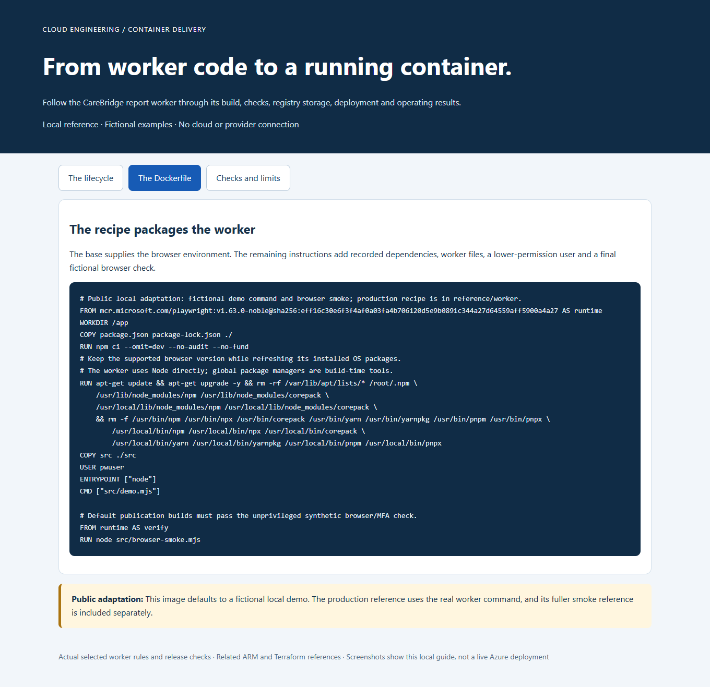
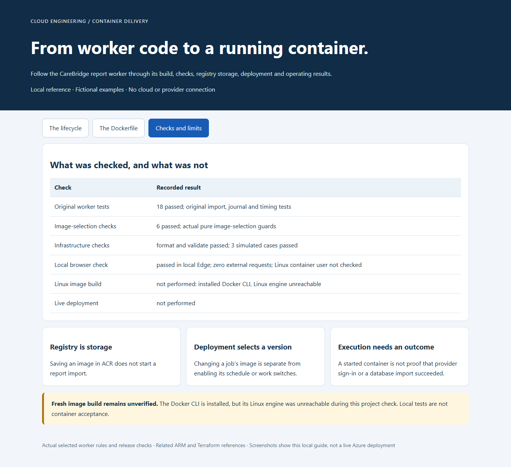

# Container Lifecycle on Azure: the CareBridge Worker

**Follow a report worker from its source code and Dockerfile to a tested image, registry storage and deployment.**

**What the worker does:** The CareBridge worker automatically retrieves reports about clients, service authorizations, appointments and visits from the CareBridge portal and submits them to the application for import. It manages the saved sign-in, checks for repeated files and records the results so staff can monitor the process.

[Business problem](#the-business-problem) · [Step by step](#step-by-step) · [What was built](#what-was-built) · [Proof](#proof-it-works) · [Commands](docs/COMMANDS.md)



## The Business Problem

The platform needs a browser-based worker to retrieve CareBridge reports. Its code, browser and supporting software must fit together, and the version tested must be the version selected for deployment.

A successful image build also does not prove a successful import. The team needs to distinguish building, storing, deploying, starting and completing useful work.

## The Solution

This case study follows the actual CareBridge worker's container design and release controls. It includes selected implementation code, the production Dockerfile as a reference, a fictional local example and related infrastructure code.

**Business outcome:** The release process connects a particular image to its checks and deployment decision, while keeping provider access and real import execution separate. The public example demonstrates those boundaries without using employee data or a live CareBridge account.

An **image** is the packaged software. A **container** is a running copy of that image, and **Azure Container Registry** is the service that stores images for deployment.

## Step by Step

1. **Prepare the worker** — Start with the report-processing code, tests and recorded software dependencies. Use a Dockerfile to describe how those pieces become a runnable image.
2. **Build and check the image** — Build the selected version and test its browser and worker behavior with fictional inputs. Review the security findings before considering that image for release.
3. **Store and select the version** — Push the accepted image to the registry and identify it by its digest, a fingerprint of the registry manifest. Update the job's image only after checking the intended release and preserved settings.
4. **Run and observe it** — Start or schedule work separately from publishing the image. Check the execution and import records, and keep a reviewed previous image for recovery.

## Architecture



The deployed CareBridge job is defined through ARM templates. The root Terraform folder here is a **new, default-Off teaching example**, not a claim that it owns the production job or should replace its state.

## What Was Built

| Part | What it demonstrates | Included code |
| --- | --- | --- |
| Actual import and journal rules | Track pending work, match the same file and avoid duplicate processing. | [Worker code](src/) and [original tests](test/) |
| Container recipe | Pin the browser base, install locked packages, use a lower-permission account and run a verification stage. | [Local adaptation](Dockerfile), [actual recipe](reference/worker/Dockerfile) |
| Image-selection checks | Reject a wrong target, changed current image, active execution or unrelated setting change. | [Actual pure guards](reference/image_selection.py) |
| Deployment references | Show the job's image, identity, disabled switches and separate execution controls. | [Fictionalized ARM reference](reference/arm/private-worker.json) |
| Related Terraform | Show a manual example job and the original reusable network module. | [Teaching job](infra/), [network reference](reference/terraform/network/) |
| Local visual guide | Explain each stage with fictional results and the current validation record. | [Preview](preview/index.html) |

## Proof It Works

- **18 original worker tests passed** for import decisions, pending-file recovery, locking and timing.
- **Six image-selection tests passed** using the extracted deployment checks and fictional job records.
- Local demonstrations show preview → committed → unchanged, and an image-selection plan that keeps the job Manual and does not start it.
- The [validation record](docs/VALIDATION.md) distinguishes local browser checks, simulated infrastructure tests and checks that still need a Linux Docker engine.

**A fresh container build and live deployment were not performed.** The Docker CLI is installed, but its Linux engine was unreachable during preparation; local Node tests are not presented as container acceptance. The public image runs a fictional demonstration, while the production reference uses the real worker entrypoint.




<details>
<summary>For engineers: run the local examples</summary>

```bash
git clone https://github.com/truthofsource/azure-container-lifecycle.git
cd azure-container-lifecycle
npm test
npm run demo
python -B -m unittest discover -s scripts -p 'test_*.py' -v
python -B scripts/demo.py
```

These selected tests need Node and Python, but no Azure account. [Commands](docs/COMMANDS.md) also cover dependency installation, Docker, Trivy, registry inspection and simulated Terraform checks.

</details>

## Strengths, Weaknesses and Tradeoffs

| Strength | Limit or cost |
| --- | --- |
| Keep tested and deployed versions identifiable | The result still depends on which checks were run and what evidence was reviewed. |
| Package the supported browser with the worker | Browser images are large and security-package downloads can make builds slow. |
| Preserve pending import work before submission | Image rollback alone cannot reconcile a lost response or recover external session state. |
| Separate image selection from job activation | Operators must verify both configuration and actual business outcomes. |
| Run without administrator privileges inside the image | Network, identity, secret access and host controls still need separate review. |

For higher report volume, measure browser startup, export waits, memory, provider limits and processing time before adding parallel workers. Keep shared sign-in and work ownership controls intact. [Operations, scaling and costs](docs/OPERATIONS-AND-SCALING.md).

## Troubleshooting Lessons

Docker’s Linux engine could work while x64 browser or SQL workloads crashed under ARM emulation. Native-runtime verification remained separate from installation and build success. [Read the incident, evidence and verification](docs/LESSONS-LEARNED.md).

## Guides

- [The full lifecycle](docs/LIFECYCLE.md)
- [The Dockerfile explained](docs/DOCKERFILE.md)
- [Pipelines, registry and deployment](docs/PIPELINES-AND-DEPLOYMENT.md)
- [Commands and Azure portal steps](docs/COMMANDS.md)
- [Troubleshooting](docs/TROUBLESHOOTING.md)
- [Source mapping and adaptations](docs/SOURCE-MAP.md)
- [Observed validation and limits](docs/VALIDATION.md)

This project publishes no image, starts no cloud service and performs no provider sign-in or import. Its GitHub check is manual-only, with an optional container build; no Actions run was dispatched to publish it.
