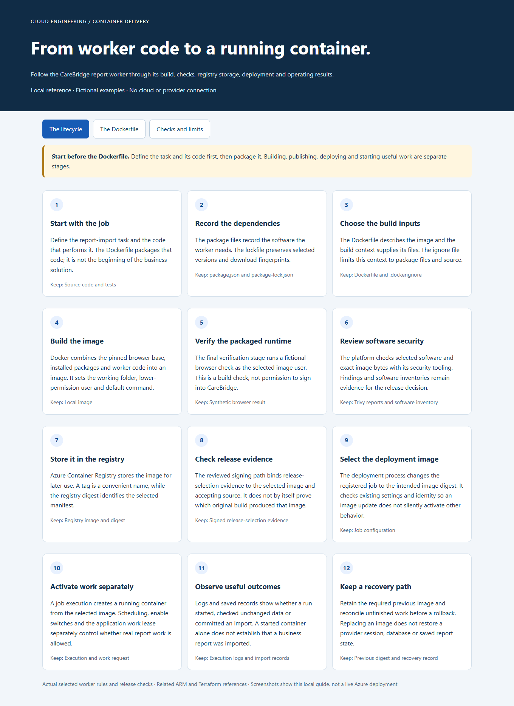
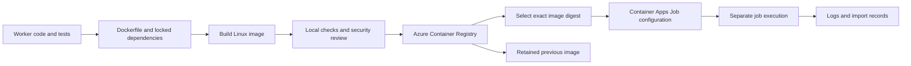
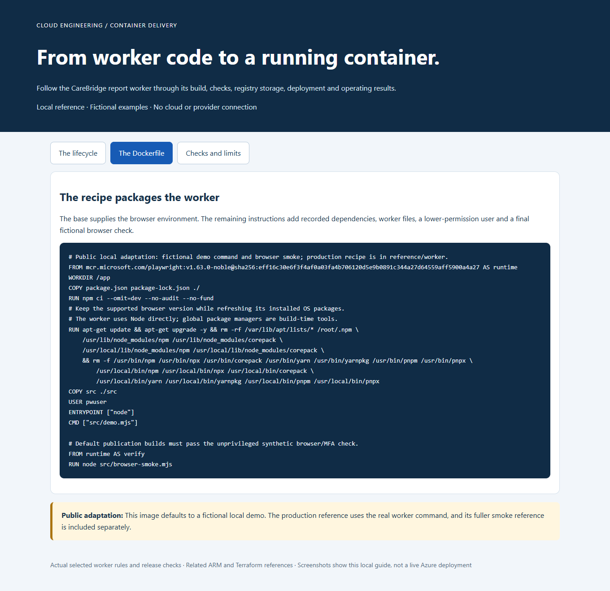
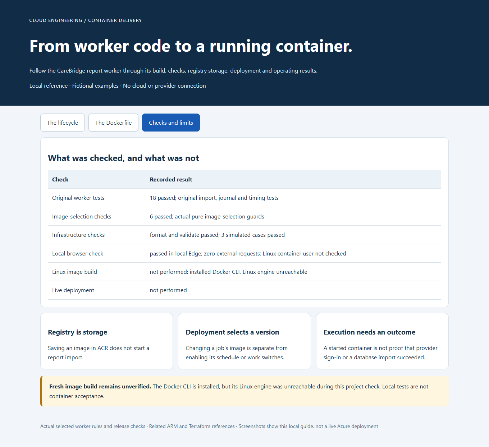

# Container Lifecycle on Azure: the CareBridge Worker

**Follow a report worker from its source code and Dockerfile to a tested image, registry storage and deployment.**

**What the worker does:** A Node.js worker uses **Playwright to control Chromium**, retrieve CareBridge reports about clients, service authorizations, appointments and visits, and submit them to the application for import. It manages the saved sign-in, checks for repeated files and records the results so staff can monitor the process.

[Business problem](#the-business-problem) · [Step by step](#step-by-step) · [What was built](#what-was-built) · [Proof](#proof-it-works) · [Commands](docs/COMMANDS.md)



## The Business Problem

The platform relies on an external-service worker to bring appointment, visit and other operational reports into the application. That worker needs its code, browser and supporting libraries to work together. A packaging or runtime mismatch can stop imports and leave staff looking at older information.

The operating team also needs to distinguish several outcomes: an image was built, it passed the selected checks, it was stored in the registry, a job selected it and a real import completed. Treating any one of those as proof of the others makes failed releases harder to diagnose and can leave the actual running version unclear.

The business need was a traceable path from source code to a selected worker image and its runtime result, with provider access and import activation controlled separately.

## The Solution

This case study follows the actual CareBridge worker's container design and release controls. It includes selected implementation code, the production Dockerfile as a reference, a fictional local example and related infrastructure code.

**Business outcome:** The release process connects a particular image to its checks and deployment decision, while keeping provider access and real import execution separate. The public example demonstrates those boundaries without using employee data or a live CareBridge account.

An **image** is the packaged software. A **container** is a running copy of that image, and **Azure Container Registry** is the service that stores images for deployment.

## Tools Used and What They Do

| Tool or service | What it does | Where it fits |
| --- | --- | --- |
| Node.js and Playwright | Run the report worker and control its browser actions. | Actual worker; selected code and fictional checks are included. |
| Chromium | Open the provider pages used for sign-in and report downloads. | Browser packaged with the worker; no live provider session in the demo. |
| Docker and BuildKit | Build the Linux image and run its verification stage. | Build tools; native-runtime acceptance is separate from an image build. |
| GitHub Actions | Coordinate the platform build and checks. | The public workflow is manual-only and does not publish to Azure. |
| Azure Container Registry | Store the image selected by its immutable digest. | Actual platform registry; no registry credentials in this reference. |
| Azure Container Apps Jobs | Execute the deployed report worker. | Actual job is ARM-defined; publication and execution are separate decisions. |
| Terraform | Demonstrate a related job and network configuration. | Public job root is a default-Off teaching equivalent, not the live job owner. |
| Trivy | Review known software weaknesses in selected image bytes. | Separate security check; a local browser pass is not a vulnerability scan. |

The Node.js demo and browser smoke use fictional inputs. The included Azure SDK packages support selected identity, secret and storage boundaries; installing them does not grant access to Azure.

## Step by Step

Your own browser-worker image, local execution evidence, registry artifact and manual Azure Container Apps Job.

[Open the standalone build guide](docs/BUILD-YOUR-OWN.md) or follow the same complete instructions below.

Start with a new folder, your own files and your own accounts. The numbered steps below describe the build; no portfolio repository checkout is required. The existing implementation/evidence elsewhere in this repository is a separate reference, not a claim that your new build has already passed.

### Prerequisites

Node/npm, Docker with a Linux engine, Azure CLI and an Azure subscription. This worker uses harmless built-in HTML; it does not connect to CareBridge or reuse any provider session.

Use Bash on Linux/macOS/WSL for Bash blocks and PowerShell for PowerShell blocks. Select the tool versions supported by the official sources below, record the versions you actually install and retain generated dependency locks. Cloud resources, scanner downloads, logs and external AI calls can create costs; review the stated scope before enabling them.

### Create your project folder

Choose a new folder name. These first commands create a blank project; an optional `git init` gives it its own history. Create parent directories in your editor when a later step introduces a nested file.

```bash
mkdir my-azure-container-lifecycle
cd my-azure-container-lifecycle
git init
```

Create `.gitignore` before saving credentials or build outputs:

```gitignore
.venv/
node_modules/
.env
.env.*
local.settings.json
credentials.json
token.json
*.pem
*.key
*.tfstate*
*.tfplan
.terraform/
private*/
captures/
backups/
batch.json
reports/
out/
app-config.local.yaml
```

The source/file snippets are a starting implementation you type or paste into the named files. Replace `YOUR_*`, names, regions and addresses only with values from your own lab; do not place real client/employee records in a test project. Keep your terminal in this project root unless a step explicitly changes directory.

Before a first commit, set your own repository-local author with `git config user.name "YOUR_NAME"` and `git config user.email "YOUR_PUBLIC_COMMIT_EMAIL"`. Review `git status --short` and the staged diff before publishing; ignored local files are not a substitute for reviewing what you upload.

### Step 1 — Create the worker source and dependency lock

**Where:** Your new folder.

Initialize your own npm package, install an exact resolved Playwright version and create worker.mjs below. Real export workers automate approved report retrieval; this standalone worker demonstrates the browser/container mechanics without a provider login.

```bash
npm init -y
npm install --save-exact playwright
```

Create **`worker.mjs`** with the following contents:

```javascript
import {chromium} from 'playwright';
import {mkdir, writeFile} from 'node:fs/promises';
await mkdir('out', {recursive: true});
const browser = await chromium.launch({args: ['--disable-dev-shm-usage']});
try {
  const page = await browser.newPage();
  await page.route('**/*', route => route.abort());
  await page.setContent('<h1>My export</h1><table><tr><td>LAB-001</td><td>Ready</td></tr></table>');
  const rows = await page.locator('tr').allTextContents();
  await writeFile('out/rows.json', JSON.stringify({rows}, null, 2));
  await page.screenshot({path: 'out/export.png'});
} finally { await browser.close(); }
```

**Check before continuing:** You have your own worker source and a matching package lock.

### Step 2 — Create the Linux image recipe

**Where:** Your project folder.

Create Dockerfile below. The build installs the browsers matching the npm package and its Linux libraries; the final process runs as a non-root user.

Create **`Dockerfile`** with the following contents:

```dockerfile
FROM node:22-bookworm-slim
WORKDIR /work
ENV PLAYWRIGHT_BROWSERS_PATH=/ms-playwright
COPY package.json package-lock.json ./
RUN npm ci --ignore-scripts && npx playwright install --with-deps chromium
COPY worker.mjs ./
RUN mkdir -p /work/out && chown node:node /work/out
USER node
CMD ["node", "worker.mjs"]
```

**Check before continuing:** The image recipe includes both the Playwright package and its browser/system dependencies.

### Step 3 — Build and run locally

**Where:** Your Docker host.

Build the image, prepare an output folder writable by your selected runtime UID, and run it without outbound networking. Review the generated rows and screenshot; do not treat a successful image build as proof that Chromium launched. This Azure job example targets linux/amd64; on another host architecture, use a compatible cross-builder/emulator and verify the target image rather than assuming a host-native build will run in Azure.

```bash
docker build --platform linux/amd64 -t my-browser-worker:lab .
mkdir -p out
docker run --rm --init --network none --cap-drop ALL --security-opt no-new-privileges   --user "$(id -u):$(id -g)" -v "$PWD/out:/work/out:rw" my-browser-worker:lab
cat out/rows.json
```

**Check before continuing:** rows.json and export.png exist from an actual browser execution.

### Step 4 — Create your own registry and publish

**Where:** Azure Portal → Container registries; then your terminal.

Create an ACR with admin access disabled, sign in through your authorized Entra identity and push your image. Record the resulting repository digest, then scan that exact artifact before selecting it for a job.

```bash
az login
az acr login --name YOUR_REGISTRY
docker tag my-browser-worker:lab YOUR_REGISTRY.azurecr.io/my-browser-worker:lab
docker push YOUR_REGISTRY.azurecr.io/my-browser-worker:lab
az acr repository show --name YOUR_REGISTRY --image my-browser-worker:lab --query digest -o tsv
```

**Check before continuing:** Your registry contains the selected image and you have its immutable digest.

### Step 5 — Create a manual job with managed pull access

**Where:** Azure Portal → Container Apps Jobs → Create.

Choose a new environment, Manual trigger and your reviewed ACR image digest. Configure a managed identity with pull access for the selected registry, bounded timeout, zero automatic retries and suitable CPU/memory; provider credentials are not needed by this example.

**Check before continuing:** The job references your digest and is not enabled on a recurring schedule.

### Step 6 — Run and inspect one execution

**Where:** Your job → Start; execution history/logs.

Start the job once and inspect its terminal status and logs. Local out files are ephemeral in the cloud; if you need retained cloud exports, first add a private storage adapter, workload identity permission and an output/idempotency contract.

**Check before continuing:** You have real container-job execution evidence without claiming that ephemeral files are a durable export pipeline.

### Step 7 — Record the lifecycle and clean up

**Where:** Your evidence and Azure Portal.

Keep source, lockfile, image digest, scan result and execution status together. Remove your isolated job/environment/registry after reviewing retained images/logs and any other dependencies.

**Check before continuing:** You can describe source → Dockerfile → image → registry → selected job → execution.

### Verification and your own screenshots

| Evidence | What to record | Your result |
| --- | --- | --- |
| New build | Your own files/resource settings and tool versions | Not yet recorded |
| Working path | The actual successful request, configuration or recovery result | Not yet recorded |
| Failure boundary | A meaningful denied, malformed, stale or failed case | Not yet recorded |
| Recovery / cleanup | What you restored or removed and what remains billed | Not yet recorded |

Capture your own architecture/configuration, one working result and one failure/recovery result. Keep tokens, credentials, personal records and private identifiers out of public screenshots. Existing portfolio images are references, not evidence that you performed these steps.

### Troubleshooting order

1. Confirm the named file, working directory and selected tool/interpreter.
2. Check the exact input and resource/account selected for the failing step.
3. Separate identity permission, network/DNS reachability and application validation.
4. Keep the actual error and reconcile an unknown write outcome before repeating it; do not widen access or repeat paid operations blindly.

The numbered steps describe a build procedure. Local syntax checks, an accepted API request, a completed hosted operation and a human verification are different evidence levels; fill in the verification table with what you actually observed.

### Official implementation references

- [playwright.dev — docker](https://playwright.dev/docs/docker)
- [learn.microsoft.com — jobs](https://learn.microsoft.com/en-us/azure/container-apps/jobs)
- [learn.microsoft.com — container-registry-authentication-managed-identity](https://learn.microsoft.com/en-us/azure/container-registry/container-registry-authentication-managed-identity)

The walkthrough layout follows the prerequisites → creation/configuration → test → verification → troubleshooting → cleanup pattern of the [Splunk project reference](https://github.com/davidharris6/splunk-siem-log-analysis). Its Splunk-specific settings are not copied into unrelated projects.

<details>
<summary>Reference: how the existing platform implementation operates</summary>

1. **Prepare the worker (Node.js)** — Start with the report-processing code, tests and recorded software dependencies. Use a Dockerfile to describe how those pieces become a runnable image.
2. **Build and check the image (Docker and Playwright)** — Build the selected version and test its browser and worker behavior with fictional inputs. Review the security findings before considering that image for release.
3. **Store and select the version (Azure Container Registry)** — Push the accepted image to the registry and identify it by its digest, a fingerprint of the registry manifest. Update the job's image only after checking the intended release and preserved settings.
4. **Run and observe it (Container Apps Jobs)** — Start or schedule work separately from publishing the image. Check the execution and import records, and keep a reviewed previous image for recovery.

</details>

## Architecture



The deployed CareBridge job is defined through ARM templates. The root Terraform folder here is a **new, default-Off teaching example**, not a claim that it owns the production job or should replace its state.

## What Was Built

| Part | What it demonstrates | Included code |
| --- | --- | --- |
| Actual import and journal rules | Track pending work, match the same file and avoid duplicate processing. | [Worker code](src/) and [original tests](test/) |
| Container recipe | Pin the browser base, install locked packages, use a lower-permission account and run a verification stage. | [Local adaptation](Dockerfile), [actual recipe](reference/worker/Dockerfile) |
| Image-selection checks | Reject a wrong target, changed current image, active execution or unrelated setting change. | [Actual pure guards](reference/image_selection.py) |
| Deployment references | Show the job's image, identity, disabled switches and separate execution controls. | [Fictionalized ARM reference](reference/arm/private-worker.json) |
| Related Terraform | Show a manual example job and the original reusable network module. | [Teaching job](infra/), [network reference](reference/terraform/network/) |
| Local visual guide | Explain each stage with fictional results and the current validation record. | [Preview](preview/index.html) |

## Proof It Works

- **18 original worker tests passed** for import decisions, pending-file recovery, locking and timing.
- **Six image-selection tests passed** using the extracted deployment checks and fictional job records.
- Local demonstrations show preview → committed → unchanged, and an image-selection plan that keeps the job Manual and does not start it.
- The [validation record](docs/VALIDATION.md) distinguishes local browser checks, simulated infrastructure tests and checks that still need a Linux Docker engine.

**A fresh container build and live deployment were not performed.** The Docker CLI is installed, but its Linux engine was unreachable during preparation; local Node tests are not presented as container acceptance. The public image runs a fictional demonstration, while the production reference uses the real worker entrypoint.




<details>
<summary>For engineers: run the local examples</summary>

```bash
npm test
npm run demo
python -B -m unittest discover -s scripts -p 'test_*.py' -v
python -B scripts/demo.py
```

These selected tests need Node and Python, but no Azure account. [Commands](docs/COMMANDS.md) also cover dependency installation, Docker, Trivy, registry inspection and simulated Terraform checks.

</details>

## Strengths, Weaknesses and Tradeoffs

| Strength | Limit or cost |
| --- | --- |
| Keep tested and deployed versions identifiable | The result still depends on which checks were run and what evidence was reviewed. |
| Package the supported browser with the worker | Browser images are large and security-package downloads can make builds slow. |
| Preserve pending import work before submission | Image rollback alone cannot reconcile a lost response or recover external session state. |
| Separate image selection from job activation | Operators must verify both configuration and actual business outcomes. |
| Run without administrator privileges inside the image | Network, identity, secret access and host controls still need separate review. |

For higher report volume, measure browser startup, export waits, memory, provider limits and processing time before adding parallel workers. Keep shared sign-in and work ownership controls intact. [Operations, scaling and costs](docs/OPERATIONS-AND-SCALING.md).

## Troubleshooting Lessons

Docker’s Linux engine could work while x64 browser or SQL workloads crashed under ARM emulation. Native-runtime verification remained separate from installation and build success. [Read the incident, evidence and verification](docs/LESSONS-LEARNED.md).

## Guides

- [The full lifecycle](docs/LIFECYCLE.md)
- [The Dockerfile explained](docs/DOCKERFILE.md)
- [Pipelines, registry and deployment](docs/PIPELINES-AND-DEPLOYMENT.md)
- [Commands and Azure portal steps](docs/COMMANDS.md)
- [Troubleshooting](docs/TROUBLESHOOTING.md)
- [Source mapping and adaptations](docs/SOURCE-MAP.md)
- [Observed validation and limits](docs/VALIDATION.md)

This project publishes no image, starts no cloud service and performs no provider sign-in or import. Its GitHub check is manual-only, with an optional container build; no Actions run was dispatched to publish it.
